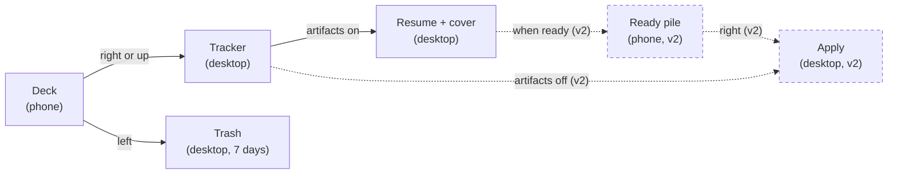

# finds-you-jobs phone companion: design brief

2026-10-10

## What the app is

[finds-you-jobs](https://github.com/SrinivasRavi/finds-you-jobs) is a desktop app that finds jobs, scores how well each fits the user, and drafts a tailored resume and cover letter for the ones they pick. The phone companion does 1 job: let the user decide, 1 card at a time, which discovered jobs are worth pursuing.

The user is a job seeker mid-search, with a deck of up to 200 scored jobs waiting. They swipe on the couch or the commute, in short bursts, often with 1 hand. A swipe should take a glance and a thumb flick, nothing more.

The phone never does the heavy work. It records decisions; the desktop generates the resume and cover letter, spending the user's own LLM budget. So the phone's other job is honesty: showing what each swipe set in motion, what it cost, and what came back.

This brief covers screens, states and behaviour.

## Screens, by phase

The MVP is 4 screens. v1 adds the offline machinery and 4 more. Design all of them; the phase says what ships first.

| Screen | Phase | What it's for |
| --- | --- | --- |
| Welcome | MVP | Explains the app needs the desktop app, offers Pair or Try the demo |
| Pair | MVP | Camera view that scans the desktop's QR code, then a confirming step |
| Deck | MVP | The swipe stack. Home screen once paired |
| Job detail | MVP | Full description, score breakdown, source, posted date. Opens on tap |
| Applications | v1 | Jobs saved from the phone, each with its generation status and spend |
| Artifact reader | v1 | Tailored resume or cover letter, read-only |
| Sync report | v1 | What happened to each offline swipe and setting edit at the last sync |
| Settings | v1 | Mirror of the desktop's settings, plus phone-only items (paired desktop, unpair, notifications) |

Navigation is a bottom tab bar from v1: Deck, Applications, Settings. The sync report opens from a banner on the deck.

## The job card

The card front answers 1 question at a glance: is this worth a closer look? Content in priority order, all of it already supplied by the desktop:

1. **Score**, 0 to 100, the biggest element. Some jobs are unscored or still scoring; those need their own treatment, never a fake number.
2. **Title and company.**
3. **Location and work style** (remote, hybrid, on-site).
4. **Salary**, only when the posting states one. A free-text string, so it can be long or odd ("$140k-$180k + equity").
5. **Top 2 or 3 score reasons**, short phrases explaining the number.
6. A **New** badge when the desktop flags the job as new.

The detail view (tap) adds the full description (long, plain text or markdown), the full score breakdown, the source board, the posted date as the source wrote it, and a link out to the original posting when one exists. Some jobs have no URL, so the link must be able to vanish cleanly.

The detail view needs the same 3 actions as the swipes, as buttons, so the user can decide after reading without going back.

## Gestures and undo

| Gesture | Meaning | What the desktop does |
| --- | --- | --- |
| Swipe right | Save | Adds the job to the tracker's Saved column, then generates artifacts if the user's settings say so |
| Swipe up | Save for a referral | Same as right, into the Seeking Referral column |
| Swipe left | Not interested | Moves the job to Trash, restorable for 7 days |
| Tap | Read more | Opens the detail view |

What the design needs to carry:

- **Direction feedback while dragging.** The card tells the user which of the 3 outcomes they're about to commit, and how close they are to the threshold. Up and right are both saves, so they need to read as related but distinct.
- **What a save will trigger.** The user's settings decide whether a save also generates a resume and cover letter. The deck should make the current behaviour visible without a trip to Settings, for example a quiet line like "Saves generate a resume and cover letter".
- **Button equivalents.** 3 buttons under the stack for users who don't swipe, and for accessibility.
- **Undo.** Undo of the last swipe, reachable for a few seconds after it. Undoing a left swipe is free. Undoing a save after generation has started is still an open decision, so design an undo that can show a short warning such as "Generation already started; $X.XX spent".
- **Running tally.** Some sense of progress through the deck and of today's decisions (saved, skipped) helps the session end on purpose.

## Pairing

Pairing happens once, on the same Wi-Fi as the desktop, and takes 1 scan. The desktop side is a Settings toggle, "Phone companion", that shows a QR code.

1. **Welcome.** 1 sentence on what the app does and that it needs finds-you-jobs running on a computer. 2 actions: Pair with my computer, Try the demo.
2. **Before the camera.** The phone will ask for camera access, then local-network access (iOS asks for this by name; Android 17 too). Prime both with 1 line each before the system prompt appears, since a denial is hard to undo.
3. **Scan.** Camera view with a framing guide and the instruction "On your computer: Settings, Phone companion, Show QR code".
4. **Connecting.** A short wait while the phone reaches the desktop and checks its identity.
5. **Paired.** Names the computer, then drops into the deck.

Failure states, each with a plain cause and 1 next step:

| What went wrong | What the user sees |
| --- | --- |
| Camera permission denied | How to allow it in system settings |
| Local network permission denied | Why it's needed and how to allow it |
| QR code expired (2 minutes, or the dialog closed) | Show a fresh code on the computer |
| Desktop unreachable | Same Wi-Fi? Computer awake? Firewall prompt on the computer accepted? |
| Identity mismatch | The computer that answered isn't the one in the QR code. Stop, never continue |
| Version mismatch | Which side to update: the desktop app or the phone app |

v1 pairs 1 phone. Pairing a new phone unpairs the old one, so the desktop warns before replacing it.

## Offline and sync (v1)

In v1 the deck works anywhere. The phone carries the top 200 jobs, the user swipes offline, and everything syncs the next time phone and computer share a Wi-Fi network with the computer awake. The MVP has none of this: every swipe goes to the desktop live, so the MVP only needs a "can't reach your computer" state.

The design needs a connection indicator that's always present and never loud. 4 states:

| State | Meaning |
| --- | --- |
| Connected | Swipes reach the computer now |
| Offline, N waiting | Swipes are queued on the phone |
| Syncing | Exchange in progress, usually a few seconds |
| Synced, with notes | Some queued actions didn't land as swiped; opens the sync report |

**The sync report** lists only what didn't go as swiped. Most syncs produce no report. The rule behind it: the most recent action on a job wins, from either device. The cases the user can see:

- **Superseded.** "You saved Stripe, Staff Engineer on your phone, then trashed it on your computer. Kept in Trash."
- **Already saved.** The computer had saved the job too; nothing changed.
- **Expired.** Saved, but the posting has since closed.
- **Gone.** The job was deleted from Trash on the computer before the swipe arrived.
- **Setting overwritten.** A setting was changed on both devices; the newer edit won. Show both values.

Each line can link to the job or the setting. The report stays until dismissed.

## Applications and artifacts (v1)

The Applications tab lists the jobs the user saved from the phone, newest first. Each row shows the job, its tracker column (Saved or Seeking Referral), and the state of its 2 artifacts:

| Artifact state | Meaning |
| --- | --- |
| Off | The user's settings skip this artifact |
| Queued | Waiting its turn on the computer |
| Generating | The computer is writing it now |
| Ready | Done; tap to read |
| Failed | Something went wrong, with the reason (for example, no LLM key set on the computer) |

**Cost is part of the row.** Each ready artifact shows what it cost on the user's own key, and the tab shows a total. finds-you-jobs promises the user always knows what they're spending, and the phone is where they spend it.

**The artifact reader** shows the tailored resume or cover letter as formatted text, read-only, with the job's title and company pinned at the top. Editing, approving and applying stay on the computer in v1, so the reader should say so in 1 line rather than leave the user hunting for an edit button.

**Notifications** are best effort in v1: the phone checks in when the OS lets it, so "Your resume for Stripe is ready" can arrive late. Real-time push comes in v1.5 with generic text only ("3 applications ready"), so job details never pass through Apple, Google or Expo.

## Settings (v1)

The phone mirrors the desktop's settings and edits them, online or offline. An edit made offline applies on the next sync, and if the same setting changed on the computer meanwhile, the newer edit wins.

3 kinds of item, and the design has to make each kind obvious:

| Kind | Examples | On the phone |
| --- | --- | --- |
| Synced, editable | Generate a resume on save, generate a cover letter on save, hard excludes, score weights, model choices | Normal controls, with a small marker when an edit is waiting to sync |
| Consent gates | LinkedIn job search, LinkedIn outreach | Shows on or off. Turning **off** works from the phone; turning **on** happens only on the computer, behind its consent screen. The control says so in place |
| Never on the phone | API keys, the LinkedIn session, mail passwords | Absent. 1 line explains they stay on the computer |

Phone-only items sit in their own group: the paired computer's name and last sync time, Unpair, notification preferences, and Try the demo.

The desktop's settings are grouped into 9 categories. The phone should follow the same grouping so a user can find a setting by the same path on both.

## Edge states and demo mode

| State | Where | What it should say or do |
| --- | --- | --- |
| Deck empty, all caught up | Deck | Done for now; when the computer last scanned for jobs |
| Deck empty, never synced | Deck | Connect to your computer to load jobs |
| Computer unreachable (MVP) | Deck | Swiping paused; same Wi-Fi, computer awake |
| Job unscored or still scoring | Card | A clear "not scored yet" treatment in the score's place |
| Generation failed | Applications | The reason, and that retrying happens on the computer |
| Unpaired by the computer | Anywhere | The computer removed this phone; pair again |
| Version mismatch after an update | Anywhere | Which app to update |

**Demo mode** exists for app-store reviewers, who can't pair with a real computer, and for anyone curious before installing the desktop app. It runs every screen against a built-in sample deck of realistic jobs, with fake generation that completes after a few seconds. A persistent, quiet marker says "Demo" so no one mistakes it for their own data, and 1 tap leaves it.

## Visual direction and constraints

- **1 codebase, 2 platforms.** Built with Expo (React Native), so 1 design serves iOS and Android. Respect each platform's navigation and system-sheet conventions where they differ; keep the deck identical.
- **Kin to the desktop app.** A user should recognise the score, the tracker column names and the artifact names from the desktop. Same words everywhere: Saved, Seeking Referral, Trash, tailored resume, cover letter.
- **Light and dark themes**, following the system setting.
- **1-handed use.** The 3 action buttons and the tab bar sit in thumb reach. Horizontal swipes must not fight Android's edge-back gesture, so the card's drag zone stays clear of the screen edges.
- **Accessibility.** Every swipe has a button and a screen-reader action. Text scales with the system font size, which means cards must survive long titles at large sizes. Reduced-motion users get a fade in place of the fling.
- **Many languages.** The desktop ships in 13. Whether the phone launches English-only is open, so leave room for strings 40% longer than English.
- **Calm.** No confetti, streaks or gamified pressure. This user is job hunting, often under stress; the app should feel like a quick, competent assistant.

## v2 preview: the second pile

v2 isn't in scope for the first designs, but the deck should be built so it can grow into it. In v2 a right swipe can apply directly when the user's settings say to apply without artifacts. And when artifacts are on, a second pile appears: applications whose resume and cover letter are ready. In that pile, right means apply and left means set aside.

So the deck component should work for 2 kinds of card (a job, and a ready application with its artifacts attached) and 2 meanings of right. v2 also allows more than 1 paired device.

The flow from first swipe to submitted application, with the v2 parts dashed:

In v1 the user's part ends at the swipe; in v2 the phone also carries the last decision, whether to send.
